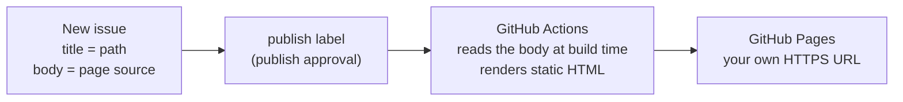

# Issue Pages — Publish HTML & JavaScript to GitHub Pages

Paste code into a GitHub Issue, add a `publish` label, and get a URL you can send to anyone. No server to manage, no CI to configure.

[中文文档](README.md) · Live examples: [🔢 Calculator](https://createsun.github.io/code-js-bin-with-issue/calculator/) · [🧩 JSON formatter](https://createsun.github.io/code-js-bin-with-issue/json-formatter/) · [⏱ Redirect](https://createsun.github.io/code-js-bin-with-issue/redirect-baidu/)

---

## What it is

Issue Pages keeps page source in GitHub Issues and compiles it into static HTML at build time with GitHub Actions, then publishes to your own GitHub Pages URL. It is meant for sharing AI-generated single-page apps, small JavaScript tools, interactive demos, and prototypes.

After the one-time setup, **every new page is just a new issue plus a label** — no repository changes.

## Quick start (one-time setup, ~3 minutes)

1. **Fork this repository.**
2. **Enable Actions:** workflows do not run in a fresh fork until you click “I understand my workflows, go ahead and enable them” on the Actions tab.
3. **Enable Pages:** Settings → Pages → Source → **GitHub Actions**. The workflow's `configure-pages` step also tries to enable it; if it fails, do it manually.
4. **Create a `publish` label:** Settings → Labels → New label, name it `publish` (used for publish approval; set `PUBLISH_LABEL` to an empty string in the workflow to turn approval off).
5. **Publish your first page:** create an issue titled `hello`, paste `<h1>Hello</h1>` as the body, and add the `publish` label.
6. Wait ~30 seconds, then open `https://<your-user>.github.io/<repo>/hello/`.

> Faster path: hand [`.agents/skills/issue-pages/SKILL.md`](.agents/skills/issue-pages/SKILL.md) to an AI coding assistant. It can fork, enable Actions and Pages, create the label, publish the first page, and report the final URL — **after confirming it returns 200**. Assistants that read `.agents/skills` (such as Chengxiaobang) pick it up automatically inside this repository; for Claude Code, copy it to `.claude/skills/`; any other assistant can simply read the file.

## Publishing a page (day to day)

1. Create an issue. **The title becomes the path** — for example `calculator`.
2. **The body is the page source:** an HTML fragment, a full HTML document, or plain JavaScript.
3. Review it (optionally `npm run preview` locally), then add the `publish` label.
4. After ~30 seconds the page is live at `https://<your-user>.github.io/<repo>/calculator/`.

Editing the body republishes automatically. **Removing the label takes the page offline.** Deleting the issue removes the page.

## What it is good for

- **AI-generated single-page apps** — ask an assistant for a complete HTML file, paste it into an issue, share the URL. (This tool does not generate code; it publishes it.)
- **Small utilities** — calculators, formatters, converters. See the live examples above.
- **Demos and prototypes** — a link your colleague or client can just open, with no login or install.
- **Anything that needs a clean public URL** without touching a server or a deployment pipeline.

## How it works



**Issues are read at build time — visitors never fetch data from the API.** Each page's HTML is generated with the body already inlined, so it loads like any static page.

## Limitations (read this first)

| Item | Reality |
| --- | --- |
| Update latency | Not real time: ~30 seconds after saving an issue. A page you just visited may sit in browser/CDN cache for a few minutes (`max-age=600`) — hard-refresh to force it |
| Static only | No backend, no database, no npm build step. To use a framework, bundle it into a single HTML file first |
| Source is public | Issue bodies are public repository content; anyone who can see the repo can read your code — **never put tokens or secrets in a page** |
| No sandbox | Pages execute code directly, and different project paths under the same account are **not** separate origins. Publish only your own or trusted code; this is **not** a platform for safely running strangers' code |
| Platform quotas | Actions and Pages usage is subject to your GitHub plan; public repositories are usually more than enough for this |
| Regional reach | `github.io` can be unreliable on some networks (notably mainland China). A custom domain with HTTPS helps but does not guarantee reachability |

## Security & publish approval

An issue goes live only when both conditions hold (otherwise it is skipped, and the reason is printed in the build log):

1. **The author is on the list** — `ISSUE_AUTHOR`, defaults to the repository owner.
2. **The `publish` label is present** — `PUBLISH_LABEL`; adding the label *is* the approval step.

The label works as an approval gate because **applying labels requires triage or write permission** on the repository, so outside contributors cannot approve their own content. For GitHub-native deployment approval (a human click on every deploy), configure Required reviewers on the `github-pages` environment in Settings → Environments — note that it gates *every* deploy, and with “Prevent self-review” enabled you need a second person.

To let others submit and you approve: leave `ISSUE_AUTHOR` empty and keep the label gate. To drop approval entirely: `PUBLISH_LABEL: ''`.

## Configuration

### Path rules

- The title is normalized into a directory name: whitespace becomes `-`, and `/\:*?"<>|#%` plus control characters are stripped. `Hello World` → `/Hello-World/`; non-ASCII titles work too (percent-encoded in the URL).
- Collisions get a `-2` suffix; an empty title falls back to `issue-<number>`.
- Paths are case sensitive. Renaming the issue changes the path and breaks the old link.

### Environment variables (build script)

| Variable | Purpose |
| --- | --- |
| `GITHUB_REPOSITORY` | `owner/repo`; injected by Actions, otherwise inferred from `git remote origin` |
| `GITHUB_TOKEN` | Optional; raises API rate limits / reads private repositories |
| `BASE_PATH` | Site prefix, e.g. `/code-js-bin-with-issue/` for a project site; defaults to `/` |
| `SITE_NAME` | Index page title; defaults to the repository name (so forks show their own name) |
| `ISSUE_AUTHOR` | Publish only this author's issues; defaults to the repository owner; empty = anyone |
| `PUBLISH_LABEL` | Approval label, defaults to `publish`; empty = no approval gate |
| `GITHUB_API_URL` | Optional; point at your own API for GitHub Enterprise |

### Local preview

```bash
npm run build      # fetch issues → dist/  (needs GITHUB_TOKEN or a gh login)
npm run preview    # serves http://localhost:8080
```

Locally `BASE_PATH=/`, so pages live at `http://localhost:8080/hello/`; on a project site there is an extra repository-name segment.

### Custom domain

Settings → Pages → Custom domain, then follow the DNS instructions. HTTPS certificates are issued automatically.

### Appearance

All styling lives in [`src/style.css`](src/style.css) and is inlined into every page at build time (no extra request). The default is a minimal [bearblog](https://bearblog.dev/)-style layout: 800px centered column, Verdana stack, light/dark via `prefers-color-scheme`. The footer is [`src/footer.html`](src/footer.html). A `<style>` block inside your page content comes after the base styles, so it can override them.

## FAQ

**How do I turn AI-generated HTML into a shareable link?**
Ask your assistant for a complete HTML file, create an issue and paste it, add the `publish` label, wait ~30 seconds, and share `https://<your-user>.github.io/<repo>/<title>/`.

**How can I share a JavaScript tool without buying a server?**
That is exactly this flow: source in an issue, static page published to GitHub Pages, with hosting and HTTPS handled by GitHub.

**How is this different from JSBin or CodePen?**
JSBin and CodePen are for **editing and live previewing** code on their platform. Issue Pages is for **publishing and hosting**: your source lives in your own repository as issues, and the page is served as a static file from your own GitHub Pages URL. There is no editor, no live preview, and no backend.

**Do visitors need a GitHub account?**
No. A published page is an ordinary static page anyone can open (network permitting).

**How long does publishing take, and do links change?**
~30 seconds after you save the issue (measured: 6 s to trigger the build, ~20 s to build and deploy). The path only changes if you change the issue title.

**Does it support a backend, a database, or an npm build?**
No. It is static hosting: HTML/CSS/JS only. Your page can call third-party APIs that send CORS headers, but there is no server-side logic.

**Can a page contain multiple files?**
One issue = one page, so inline your CSS and JS into a single HTML file. For multi-file projects, use a custom domain on a dedicated repository.

## Repository layout

```
scripts/build.mjs              fetch issues → generate dist/ (body inlined at build time)
src/page.html                  fragment wrapper: __STYLE__ / __TITLE__ / __CONTENT__ / __FOOTER__
src/style.css                  base stylesheet, inlined into every page
src/footer.html                site footer
src/404.html                   static not-found page
.agents/skills/issue-pages/SKILL.md   fork + deploy skill for AI assistants
.github/workflows/deploy-pages.yml   builds and deploys on issue / push events
dist/                          build output (not committed)
```

## License

[MIT](LICENSE).
