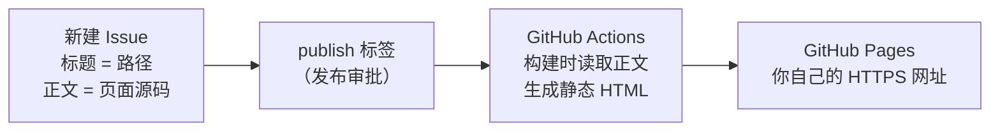

# Issue Pages：把 HTML / JavaScript 发布成可分享的网页

**Publish HTML & JavaScript to your own GitHub Pages URL.** 把代码粘进一个 Issue，打上 `publish` 标签，就得到一条能直接发给任何人的网址——不用买服务器，也不用配 CI。

[English](README.en.md) · 在线示例：[🔢 计算器](https://createsun.github.io/code-js-bin-with-issue/calculator/) · [🧩 JSON 格式化](https://createsun.github.io/code-js-bin-with-issue/json-formatter/) · [⏱ 2 秒后跳转](https://createsun.github.io/code-js-bin-with-issue/redirect-baidu/)

---

## 这是什么

Issue Pages 用 GitHub Issues 保存页面源码，用 GitHub Actions 在构建时把它们编译成静态 HTML，再发布到你自己的 GitHub Pages 地址。适合分享 AI 生成的单页应用、JavaScript 小工具、交互演示和原型。

首次配置完成后，**每新增一个页面只要创建一个 Issue 并加个标签**，不需要再动仓库。

## 30 秒上手（首次配置，约 3 分钟）

1. **Fork 本仓库**，得到你自己的副本。
2. **打开 Actions**：Fork 出来的仓库默认不会跑工作流，在 Actions 页点一次 “I understand my workflows, go ahead and enable them”。
3. **先启用 Pages**：Settings → Pages → Source 选 **GitHub Actions**。也可以命令行开：

   ```bash
   gh api -X POST repos/<你的用户名>/<仓库名>/pages -f build_type=workflow
   ```

   这一步必须在第一次运行之前做：`GITHUB_TOKEN` 没有创建 Pages 站点的权限，没启用就运行会直接失败（报错里会给出上面这条命令和设置页链接，照着做完重跑即可）。
4. **建一个 `publish` 标签**：Settings → Labels → New label，名字 `publish`（发布审批用，见下文；不想用审批就把工作流里的 `PUBLISH_LABEL` 设为空字符串）。
5. **发第一张页面**：新建 Issue，标题写 `hello`，正文粘贴 `<h1>Hello</h1>`，然后给这个 Issue 加上 `publish` 标签。
6. 等 Actions 跑完（约 30 秒），访问 `https://<你的用户名>.github.io/<仓库名>/hello/`。

> 更省事：把 [`.agents/skills/issue-pages/SKILL.md`](.agents/skills/issue-pages/SKILL.md) 交给你的 AI 助手，它可以替你完成 fork、开 Actions、启用 Pages、建标签、发布第一个页面，并**在 curl 到 200 之后**把最终网址回报给你。支持 `.agents/skills` 的助手（如程小帮）在这个仓库里会自动发现它；Claude Code 用户把它拷到 `.claude/skills/` 即可，其他助手直接让它读这个文件。

## 日常发布一条页面

1. 新建 Issue，**标题就是这个页面的路径**，例如 `calculator`。
2. **正文就是页面源码**：HTML 片段、完整 HTML 文档，或者纯 JavaScript。
3. 核对内容（也可以本地 `npm run preview` 先看），然后加上 `publish` 标签。
4. 约 30 秒后访问 `https://<你的用户名>.github.io/<仓库名>/calculator/`。

改正文会自动重新发布；**去掉 `publish` 标签页面就下线**；删除 Issue 页面随之消失。

## 适用场景

- **AI 生成的单页应用**：让 AI 直接输出完整 HTML，粘进 Issue 就有一个能分享的网址（本工具不生成代码，只负责发布）。
- **临时小工具**：计算器、编码转换、文本处理——见上方的在线示例。
- **交互演示 / 原型**：发给同事或客户点一下就能用，不需要对方登录或安装。
- **需要一条干净链接的场合**：做活动页、做一次性落地页，不想碰服务器和部署流水线。

## 工作原理



**读取 Issue 发生在构建期，访客打开页面时不再请求任何数据**：每个页面的 HTML 在构建时就生成好了，正文被直接写进文件，所以打开速度就是静态页面的速度。

## 限制（先看这里，避免踩坑）

| 事项 | 现状 |
| --- | --- |
| 更新延迟 | 不是实时发布：Issue 保存后约 30 秒上线；刚访问过的页面可能被浏览器/CDN 缓存几分钟（`max-age=600`），强刷一次即可 |
| 只有静态页面 | 没有后端、数据库，也没有 npm 构建。要用框架得先把产物打成单文件 HTML 再粘贴 |
| 代码是公开的 | Issue 正文属于公开仓库内容，能看到仓库的人都能看到源码——**不要放 token、密钥** |
| 没有沙箱隔离 | 页面直接执行代码，同一账号下不同项目路径也**不是**不同源。只适合发布你自己或可信作者的代码，**不能当作"安全运行陌生人代码"的平台** |
| 平台额度 | Actions 与 Pages 的使用受 GitHub 套餐限制，公开仓库日常使用通常绰绰有余 |
| 国内访问 | `github.io` 在国内网络下可能不稳定；配置自定义域名 + HTTPS 可以改善，但不保证可达 |

## 安全与发布审批

一个 Issue 要上线，得同时满足两个条件（不满足就跳过，原因会打在构建日志里）：

1. **作者在名单里**——`ISSUE_AUTHOR`，默认等于仓库 owner。
2. **打了 `publish` 标签**——`PUBLISH_LABEL`，这就是审批动作。

标签能当审批用，是因为**打标签需要仓库的 triage 或 write 权限**：外部投稿人做不到自己批准自己。想要 GitHub 原生的部署审批（每次部署都要人工点一次），在 Settings → Environments → `github-pages` 里配 Required reviewers；注意它拦的是每一次部署，且「Prevent self-review」打开后你需要第二个人来批准。

想让别人投稿再由你审批：把 `ISSUE_AUTHOR` 留空、保留标签门即可。想彻底关掉审批：`PUBLISH_LABEL: ''`。

## 高级配置

### 路径规则

- 标题去掉首尾空白、空白折成 `-`、剔除 `/\:*?"<>|#%` 与控制字符后作为目录名：`Hello World` → `/Hello-World/`；中文标题也可以（浏览器会做百分号编码）。
- 归一化后重名的第二个会加 `-2` 后缀；标题为空则用 `issue-<编号>`。
- 大小写敏感；改标题会换路径，旧链接失效。

### 环境变量（构建脚本）

| 变量 | 说明 |
| --- | --- |
| `GITHUB_REPOSITORY` | `owner/repo`，Actions 自动注入；本地缺失时从 `git remote origin` 推断 |
| `GITHUB_TOKEN` | 可选，提高 API 速率限制 / 读取私有仓库 Issue |
| `BASE_PATH` | 站点前缀，项目站点形如 `/code-js-bin-with-issue/`，默认 `/` |
| `SITE_NAME` | 首页标题，默认取仓库名（Fork 后自动是对方的名字） |
| `ISSUE_AUTHOR` | 只发布该作者的 Issue，默认仓库 owner；空字符串 = 不限作者 |
| `PUBLISH_LABEL` | 发布审批标签，默认 `publish`；空字符串 = 关闭审批 |
| `GITHUB_API_URL` | 可选，GitHub Enterprise 时指向自己的 API |

### 本地预览

```bash
npm run build      # 拉取 Issue 生成 dist/（需要 GITHUB_TOKEN 或 gh 登录态）
npm run preview    # 起在 http://localhost:8080
```

本地默认 `BASE_PATH=/`，路径是 `http://localhost:8080/hello/`；线上是项目站点，前面多一层仓库名。

### 单页体积上限

Issue 正文上限是 **65536 字符**，也就是这个站点单页的上限。页面（含内联的图片/SVG/CSS/JS）必须压进这个数字；超了就让页面本身变小或变轻，**不要**在仓库里另建资产目录绕过它——那样内容就不在 issue 里了。压不下的常见做法：裁掉装饰性细节、把坐标量化到整数/2 单位、把大的矢量或文本用 `gzip + base64` 内联再由页面解压（见 `bambu-a1-mini` 那个 issue 的写法）。

### 自定义域名

在 Settings → Pages → Custom domain 里填域名，并按提示配置 DNS（HTTPS 由 GitHub 自动签发证书）。

### 外观

样式集中在 [`src/style.css`](src/style.css)，构建时内联进每个页面（不发额外请求），默认是一套参考 [bearblog](https://bearblog.dev/) 的极简排版：800px 窄栏居中、Verdana 字体栈、跟随系统深浅色。页脚在 [`src/footer.html`](src/footer.html)。内容片段里的 `<style>` 写在基础样式之后，可以覆盖单页样式。

## FAQ

**如何把 AI 生成的 HTML 变成可访问链接？**
让 AI 输出完整 HTML，新建 Issue 粘贴进去，加 `publish` 标签，等约 30 秒，链接就是 `https://<你的用户名>.github.io/<仓库名>/<标题>/`。

**不买服务器怎么分享一个 JavaScript 小工具？**
就是这套流程：Issue 里放源码，构建时变成静态页面发布到 GitHub Pages，托管和 HTTPS 都由 GitHub 提供。

**它和 JSBin / CodePen 有什么区别？**
JSBin / CodePen 面向**在线编辑和实时预览**，内容活在它们的平台上；Issue Pages 面向**发布和托管**——内容以 Issue 形式存在你自己的仓库、页面发布到你自己域名的静态地址。它没有编辑器、没有实时预览、没有后端。

**访客需要 GitHub 账号吗？**
不需要。发布出来就是普通静态网页，任何人可访问（前提是网络能到 `github.io`）。

**发布要多久？改完链接会变吗？**
保存 Issue 后约 30 秒上线（实测：6 秒触发构建 + 约 20 秒构建部署）。只要标题不变，路径就不变；改标题才会换路径。

**支持后端、数据库、npm 构建吗？**
不支持。它是静态托管：只有 HTML/CSS/JS，前端可以直接调用带 CORS 的第三方接口，但没有服务端逻辑。

**一个页面能放多个文件吗？**
一个 Issue 对应一个页面，所以把 CSS/JS 内联进去（单文件 HTML）。需要多文件就配自定义域名的独立仓库。

## 目录结构

```
scripts/build.mjs              拉取 Issue → 生成 dist/（正文在构建时写进页面）
src/page.html                  片段模式的外壳：__STYLE__ / __TITLE__ / __CONTENT__ / __FOOTER__ 占位
src/style.css                  站点基础样式，构建时内联进每个页面
src/footer.html                每页底部的页脚
src/404.html                   未命中路径时的纯静态提示页
.agents/skills/issue-pages/SKILL.md  给 AI 助手用的 fork + 部署技能
.github/workflows/deploy-pages.yml   Issue/推送触发构建并发布到 Pages
dist/                          构建产物（不入库）
```

## 许可

[MIT](LICENSE)。
